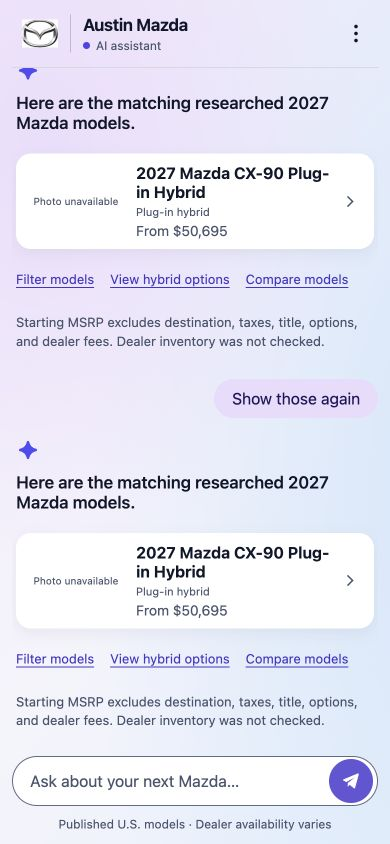
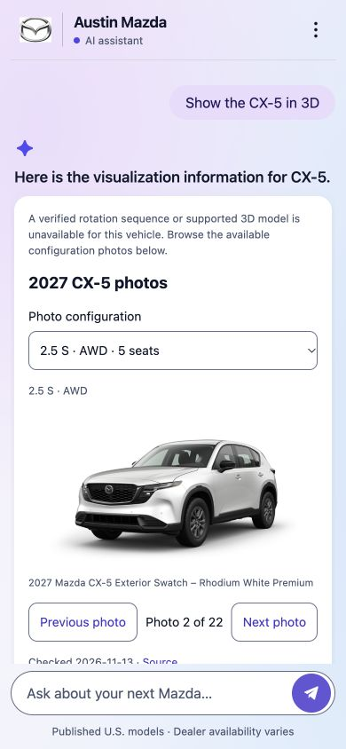

# Release remediation

## Acceptance criteria

This pass addresses the four findings from the live end-to-end test: contextual follow-up consistency, unsupported photo descriptions, response latency, and missing visual assets. Execution remains on the local Mac with configured OpenAI inference only; no deployment.

1. Routine supported catalog queries, including full-transcript follow-ups, produce repeatable source-backed UI and complete within one second in local repeated endpoint tests.
2. Photo answers use applicable source assets and explicit source labels, never inferred upholstery or viewing angles. Missing imagery has an honest empty state.
3. Unavailable rotation does not appear as a working action. Explicit rotation requests provide a photo fallback. Actual rotation requires verified frames for the selected configuration.
4. OpenAI remains reachable for interpretation beyond the known catalog intents, with a bounded wait and safe recovery. Fast local results are not reported as live model calls.
5. The complete raw tool result remains in the handoff between curator and presentation stages, including image URLs and nested source metadata.
6. Local request storage is never described as a dealer booking or automatic dealer handoff.

## Ownership

Engineering manager: conversation context, endpoint integration, integrated acceptance and browser checks. AI workstream: runtime routing and presentation contracts. Frontend workstream: media applicability and available controls. QA workstream: repeated endpoint acceptance, opt-in live checks, data gap inventory.

## Architecture refinement

The two-stage curator/presentation pipeline remains. Recognized catalog requests use grounded local tool execution and registered presentation policies. OpenAI remains the fallback for interpretation outside that bounded route. This eliminates redundant model restatements of prices, image labels and filter results. Complete tool records remain independent of prose.

This follows the [OpenAI latency guidance](https://developers.openai.com/api/docs/guides/latency-optimization): reduce sequential calls and use conventional code for constrained outputs.

## Asset inventory

The source contains 718 asset rows (713 image URLs and five documents), but no local vehicle photographs or meshes. Model-specific media is available for CX-5 and CX-90 MHEV; Mazda3 and CX-90 PHEV lack exact model imagery. All 84 visualization rows lack usable frames and mesh URLs: 81 observed directories and three no-mesh findings. These missing source assets cannot be generated or relabelled as authentic vehicle data.

## Results

- **66 backend tests passed**, including 21 runtime tests and configured-key acceptance with network calls prohibited for known catalog requests.
- **40 frontend tests passed**, and production bundle build passed.
- **14/14 standard endpoint journeys passed**, including repeated PHEV follow-ups and reset behavior, at 19–58 ms in the measured run.
- **70 repeated requests passed with zero assertion failures**; median 37.8 ms, maximum 60.2 ms. These timings are in-process local endpoint measurements, not internet or mobile-device performance promises.
- **Actual OpenAI fallback verified separately:** an unfamiliar general wheelbase question returned HTTP 200 in 5.5 seconds. Catalog fast paths intentionally make no model request. A shared 20-second deadline bounds model work; timeouts remain retryable errors, not guaranteed successful model answers.
- Browser on local loopback: discovery, PHEV-only follow-up, repeated follow-up, removal of unsupported 360° action, honest PHEV photo empty state, CX-5 visualization gallery fallback, and Next-photo navigation verified. Displayed CX-5 image loaded successfully. Mobile viewport: 390×844.
- Capability overview answers are now fixed to the exact researched 2027 Mazda3/CX-5/CX-90 scope. Visualization text no longer exposes directory-status jargon.

Evidence: `ga-catalog-results.json`, `ga-repeated-results.json`, `ga-openai-result.json`, `ga-followup.jpg`, `ga-gallery.jpg`.

## Changed files

`backend/conversation.py`, `backend/main.py`, `backend/openai_runtime.py`, `frontend/src/CarList.jsx`, `frontend/src/VehicleExperience.jsx`, `frontend/tests/components.test.jsx`, `tests/test_conversation.py`, `tests/test_openai_runtime.py`, `tests/test_release_acceptance.py`, `tests/live_e2e.py`, and this report/evidence. No data provenance was changed and no substitute vehicle imagery was invented.

## Release scope and remaining external requirements

The verified local catalog experience passes this remediation acceptance. Original intermittent follow-up, generated photo-descriptor, routine latency, and unusable visualization-control defects are resolved. Missing media is handled with explicit unavailable states and gallery fallback; the actual missing image/3D files have **not** been supplied.

This is a local release candidate, not a deployed or independently certified public GA service. Exact Mazda3/PHEV photos and verified per-configuration rotation frames or meshes are required to enable those features. Live dealer inventory/calendar operations remain outside the approved repo-data scope. Public operational acceptance (deployment environment, access control/rate limits, observability, load testing, media permissions and physical-device/assistive-technology coverage) is not established by this local pass. No deployment was performed.

