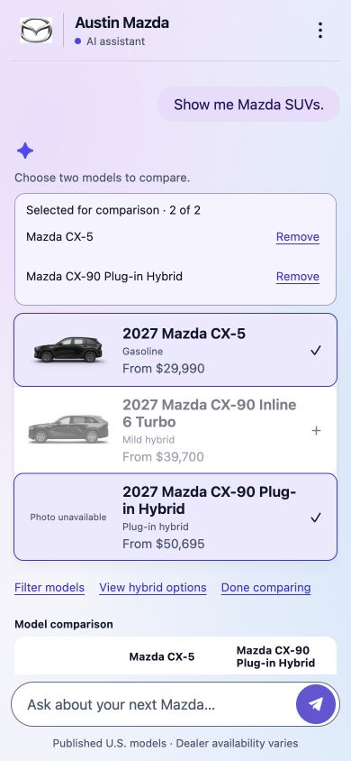

# Local end-to-end verification — 2026-11-13

Repository: `/Users/lancedsilva/Documents/ChatGPT/Adaptive UI/adaptive-ui`.
Execution: user's local Mac; the configured OpenAI API supplies inference. No deployment or remote build/test execution. Model configured for this run: `gpt-5-mini`. Credentials were not printed or stored in evidence.

## Architecture under test

FastAPI coordinates two model stages. The first calls five local CSV-backed vehicle tools; complete raw results are retained independently of its prose. The second selects registered UI functions by source-call ID and record index. Server validation builds props from source records; the browser renders bundled React components. Local test-drive requests use atomic CSV persistence and idempotency, with no dealer calendar or booking integration. The visual theme follows the project's Aurora Light mockups.

## Reproducible local checks

From the repository:

```sh
.venv/bin/python -m unittest discover -s tests -v
```

From `frontend/`:

```sh
npm test
npm run build
```

Explicit live API run (incurs configured API usage):

```sh
.venv/bin/python tests/live_e2e.py --run-live --output /tmp/adaptive-live-comprehensive.json
```

Use `--cases details followup booking` for a targeted retest. Automated checks validate HTTP contracts, UI component selection and important source values. They do not establish prose accuracy or GA readiness; manual review remains required.

## Deterministic results

- Backend: 53 tests passed, including six real HTTP flows, catalog identity and applicability, source preservation, invalid tool input, AI timeouts and credential-safe failures, exact trim IDs, follow-up presentation eligibility, atomic request storage and concurrent idempotency.
- Frontend: 33 component/calculator tests passed using real catalog fixtures and empty data. These are server-rendered component checks, not browser interaction tests.
- Frontend production bundle: passed.
- Existing warning: Starlette's TestClient reports its httpx integration is deprecated. It does not fail these tests.

## Browser checks

Verified live discovery renders source-backed vehicle cards. Opened financing from a card; a $30,000 price, $5,000 down payment, 0% APR and 60 months produces $416.67/month. Down payment above price shows validation instead of a payment. A failed AI response shows a retry control. After restarting the final backend, a fresh browser query for CX-5 Preferred rendered the exact trim at $34,550, destination $1,595, and base plus destination $36,145.

At 390×844, comparison accepts two vehicles, disables a third, displays the selected model names and source prices, and has no document-level horizontal overflow. The local request form discloses local-only storage and separate dealer contact. Empty submission focuses the required vehicle field. No real appointment was created during browser testing; persistence/retry tests use temporary directories.



## Defects found and repaired during this pass

- Live detail answers could show Preferred pricing in prose with a base-model card. Exact IDs now constrain tool calls; detail requests require the appropriate successful detail result, and broad search cards cannot replace those details.
- Hybrid follow-ups could display all SUV cards. Server-side eligibility now filters presentation indices while retaining full source data in the agent handoff.
- An interior-options section could become a general image gallery. Incompatible gallery substitution is rejected unless photos were requested.
- Comparison could stop after a search and produce prose without the comparison component. A bounded completion check now requires the comparison tool for two unambiguous named models; the targeted live retest passed in 59.1 seconds.
- AI copy could promise live dealer stock or scheduling. Capability instructions now explicitly describe local data and the local request form, prohibit dealer-contact/booking promises, and direct customers to contact the dealer separately. This remains model behavior requiring live review.
- Near-zero positive APR could produce an infinite payment. Stable `expm1`/`log1p` arithmetic and a regression test fix the calculation.
- Discovery tests unintentionally used the configured live API. Test settings now explicitly isolate offline test runs.

## Changed files in this verification pass

`backend/openai_runtime.py`, `frontend/src/VehicleExperience.jsx`, `tests/test_openai_runtime.py`, `tests/test_discovery.py`, `tests/test_http_flows.py`, `tests/live_e2e.py`, `frontend/test.mjs`, `frontend/tests/components.test.jsx`, `frontend/package.json`, and this verification folder. The repository has no tracked baseline, so Git reports the whole project as untracked; this list describes the work in this verification pass rather than a commit diff.

## Remaining acceptance limits

A local request is not a confirmed dealer appointment. Live stock/calendar integration is deliberately absent under the approved repo-data scope. Verified rotation frames/3D meshes and exact PHEV imagery are missing. Third-party media reuse permission is unverified in source records. Physical-device/VoiceOver testing, broader browser coverage, load testing, and production operational review are still outstanding. No GA approval is implied by passing local tests.

## API implementation reference

The runtime executes model-requested tools locally and returns their results to the model following the [OpenAI function-calling workflow](https://developers.openai.com/api/docs/guides/function-calling). Application validation remains responsible for source identity and presentation eligibility.

## Open issues from manual review

- **P2 — follow-up presentation:** “Which of those is a plug-in hybrid?” still returned a broad textual overview in the final batch instead of a PHEV-only card. Eligibility validation prevented displaying unrelated cards but does not ensure a focused model answer.
- **P2 — image factual grounding:** the photo answer described “cloth/leather look” where the CSV caption is “Black Cloth,” and inferred “front” from a filename. The URLs are valid source references, but these descriptive additions remain unsupported by explicit captions.
- **P2 — answer polish:** financing repeated loyalty information already included in its UI; unsupported-year guidance offered another unresearched year; some subscription features omit trial/fee qualifiers from prose even though full source data is retained.
- **Performance:** successful live turns take tens of seconds; the corrected comparison retest took 59.1 seconds. This is insufficient evidence of reliable production latency.

These findings keep GA acceptance open. The API key and model integration work, but this pass does not establish that every answer is consistently focused, grounded, and fully presented.

## Final live batch

All 12 scenarios returned HTTP 200. Ten passed their automated assertions; comparison and PHEV follow-up failed the expected UI checks. The subsequent comparison fix passed its targeted live retest. This is not a 12/12 complete-experience pass.

| Scenario | Seconds | Automated checks |
|---|---:|---|
| discovery | 16.6 | passed |
| details | 39.4 | passed |
| colors | 21.0 | passed |
| photos | 32.2 | passed |
| comparison | 32.7 | failed |
| finance | 24.3 | passed |
| followup | 26.2 | failed |
| mild | 29.7 | passed |
| year | 8.0 | passed |
| rotation | 44.2 | passed |
| booking | 18.9 | passed |
| injection | 4.2 | passed |

Evidence: `live-comprehensive.json` and `live-comparison-retest.json`. Manual findings above override any broad interpretation of automated success.

## Final booking hardening

The live batch still implied a dealer would review the locally saved request. Booking and false-confirmation intents now receive deterministic local-only instructions without calling the model or tools. Both final HTTP retests passed in under 0.1 second and manual review confirmed: saved on this computer only, not sent to the dealership, no availability checked, no appointment confirmed, and separate dealer contact required. Evidence: `booking-final.json`. The final deterministic suite is 53 backend tests and 33 frontend tests, all passing; the production build passes.
